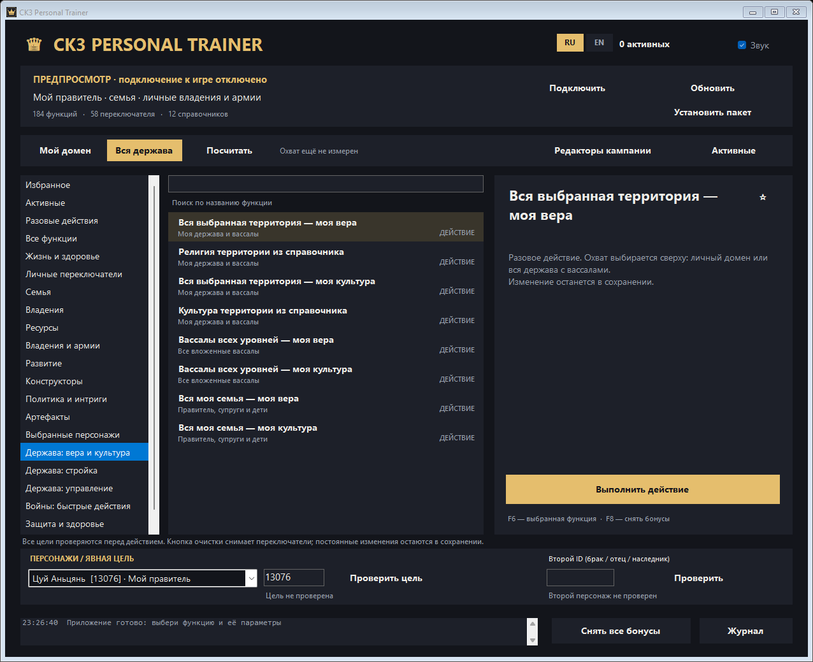
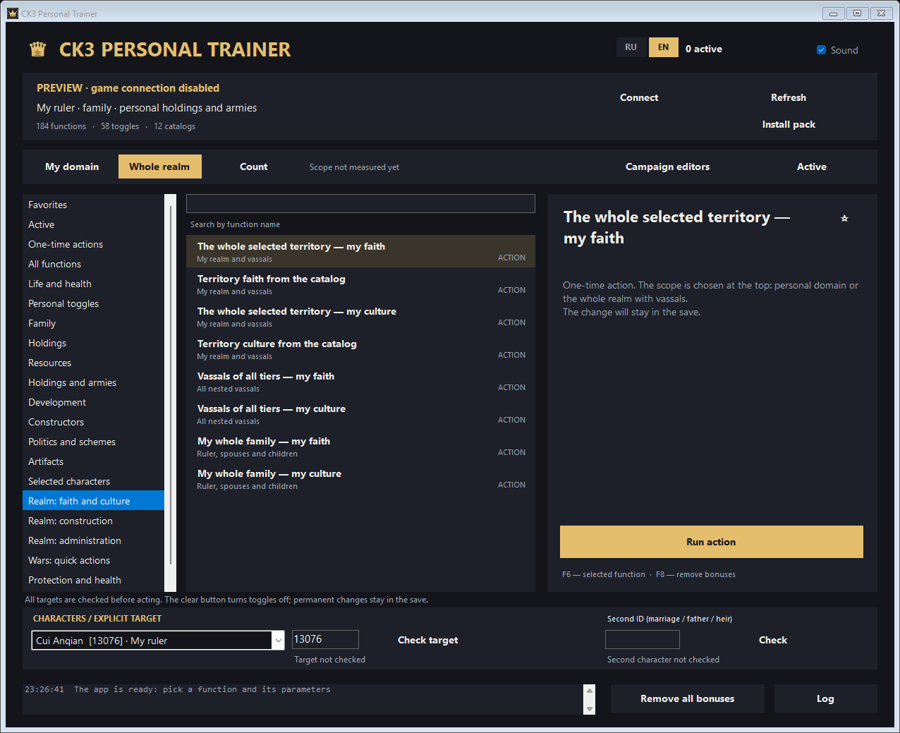

# CK3 Personal Trainer

**Русский** · [English](#english)

Трейнер и редактор кампании для одиночной **Crusader Kings III 1.20.0.4 «Crozier»** (Windows x64).
184 функции в основном окне (58 переключателей и разовые действия), 240 действий редактора кампании в 14 группах,
включая 15 сюжетных сценариев. Интерфейс на русском и английском, переключение кнопками **RU / EN** без перезапуска.



## Установка

1. Скачайте архив `CK3Trainer-<версия>.zip` из [Releases](https://github.com/jestelf/CK3Trainer/releases/latest) и распакуйте его
   в папку с правом записи (не в `Program Files`). Все файлы архива должны лежать рядом с `CK3Trainer.exe`.
2. Нужен .NET Framework 4.8 (есть в Windows 10/11). Права администратора не нужны.
3. Установите пакет игровых файлов: кнопка **«Установить пакет»** в трейнере или
   `powershell -ExecutionPolicy Bypass -File install-pack.ps1` (путь к игре находится через Steam; можно указать `-GameDirectory "путь к Crusader Kings III"`).
   Пакет добавляет в папку игры 10 собственных файлов (модификаторы, черты, локализация RU/EN) и не изменяет оригинальные файлы.
4. Если CK3 была запущена, сохраните кампанию и **перезапустите игру вручную** — пакет загружается только при старте.
5. Загрузите одиночную кампанию, запустите `CK3Trainer.exe` и нажмите **«Подключить»**.

## Как пользоваться

* **«Мой домен» / «Вся держава»** — охват массовых действий: личные графства или вся держава с вложенными вассалами. **«Посчитать»** показывает размер охвата.
* Слева — группы, в центре — функции, справа — описание и кнопка. Звёздочка добавляет функцию в избранное. Поиск работает по названию и описанию.
* Для действий над другим персонажем выберите его или введите внутренний ID и нажмите **«Проверить цель»**. Второй персонаж (брак, отцовство, наследование) проверяется отдельно.
* **«Редакторы кампании»** открывают окно с 240 действиями: семья и наследование, двор, титулы и земли, вера и культура, артефакты, войны и армии, интриги, регентство, лагерь, кочевники, администрация и сценарии.
  Каждое действие сначала показывает предпросмотр с конкретными целями, затем выполняется кнопкой «Выполнить по предпросмотру».
* F6 — выполнить выбранную функцию, F8 — снять все переключатели (когда окно трейнера активно).
* **«Снять все бонусы»** выключает переключатели. При закрытии трейнер сам снимает свои бонусы. Разовые действия (постройки, конверсии, войны, браки, ресурсы) остаются в сохранении.

## Как это работает

Трейнер передаёт команды в штатную очередь консоли CK3 через временный оконный канал и проверяет результат по журналу игры.
Управляемый персонаж игрока не подменяется. Несколько функций (абсолютная защита от смерти, точный счёт войны, завершение осады)
ставят короткие переходы в код игры только пока включены и снимают их при отключении или закрытии.
Перед любой записью проверяется точная версия `ck3.exe`: на другой сборке трейнер не подключится.
Сетевых запросов, внедрения DLL и автозапуска нет. Настройки и журнал хранятся в `%LOCALAPPDATA%\CK3PersonalTrainer`.

## Что проверено

Подключение к игре, отключение, команды основного окна (парсер игры принял 132 пакета), личные и семейные бонусы с точным снятием.
Часть массовых и необратимых действий редактора (победы в войнах, массовые постройки, нативные осады и счёт войны)
проверялась на синтаксис и в эмуляторе, но не на каждой кампании — сохраняйтесь перед крупными изменениями.
Это инструмент для одиночной игры; в мультиплеере не используйте.

## Удаление

Снимите бонусы кнопкой трейнера, сохраните кампанию, закройте игру и выполните
`powershell -ExecutionPolicy Bypass -File uninstall-pack.ps1`. Удаляются только файлы пакета, если их контрольные суммы совпадают.

## Антивирусы

Exe не подписан и работает с памятью процесса игры, поэтому некоторые антивирусы могут предупредить о нём. Весь исходный код —
в папке `src`, exe можно собрать самостоятельно. SHA-256 указан в описании выпуска.

## Сборка

Нужен .NET SDK (используется только компилятор Roslyn) и .NET Framework 4.8:

```
powershell -ExecutionPolicy Bypass -File build.ps1
```

## Связанные репозитории

* [CK3PersonalCheatMenu](https://github.com/jestelf/CK3PersonalCheatMenu) — внутриигровое меню читов в виде мода.
* [CK3Research](https://github.com/jestelf/CK3Research) — исследование игровых функций и скриптов CK3, на котором построены трейнер и мод.

Лицензия — MIT.

---

<a name="english"></a>

# CK3 Personal Trainer (English)

A trainer and campaign editor for single-player **Crusader Kings III 1.20.0.4 "Crozier"** (Windows x64).
184 functions in the main window (58 toggles plus one-time actions) and 240 campaign editor actions in 14 groups,
including 15 story scenarios. The interface is available in Russian and English; switch with the **RU / EN** buttons, no restart needed.



## Installation

1. Download `CK3Trainer-<version>.zip` from [Releases](https://github.com/jestelf/CK3Trainer/releases/latest) and extract it to a
   writable folder (not `Program Files`). Keep all files next to `CK3Trainer.exe`.
2. .NET Framework 4.8 is required (included in Windows 10/11). Administrator rights are not needed.
3. Install the game file pack: the **Install pack** button in the trainer, or
   `powershell -ExecutionPolicy Bypass -File install-pack.ps1` (the game is found through Steam; you can pass `-GameDirectory "path to Crusader Kings III"`).
   The pack adds 10 files of its own to the game folder (modifiers, traits, RU/EN localization) and does not modify original game files.
4. If CK3 was running, save the campaign and **restart the game manually** — the pack is only loaded at startup.
5. Load a single-player campaign, start `CK3Trainer.exe` and press **Connect**.

## Usage

* **My domain / Whole realm** sets the scope of mass actions: personal counties, or the whole realm with all nested vassals. **Count** shows the size of the scope.
* Groups are on the left, functions in the middle, the description and run button on the right. The star adds a function to Favorites. Search covers names and descriptions.
* For actions on another character, pick them or enter their internal ID and press **Check target**. The second character (marriage, fatherhood, succession) is checked separately.
* **Campaign editors** opens a window with 240 actions: family and succession, court, titles and land, faith and culture, artifacts, wars and armies, schemes, regency, camp, nomads, administration and scenarios.
  Every action first shows a preview with the exact targets, then runs with **Run as previewed**.
* F6 runs the selected function, F8 turns off all toggles (while the trainer window is active).
* **Remove all bonuses** turns toggles off. The trainer also removes its bonuses when it closes. One-time actions (buildings, conversions, wars, marriages, resources) stay in the save.

## How it works

The trainer sends commands to CK3's own console queue through a temporary window channel and checks the result in the game log.
The player's played character is never swapped. A few functions (full death protection, exact war score, siege completion)
place short jumps into the game code only while enabled and remove them when turned off or on exit.
The exact `ck3.exe` build is verified before any write: the trainer will not connect to another game version.
There are no network requests, DLL injection or autostart. Settings and logs are stored in `%LOCALAPPDATA%\CK3PersonalTrainer`.

## What was tested

Connecting and disconnecting, main window commands (the game parser accepted 132 command batches), personal and family bonuses with exact removal.
Some mass and irreversible editor actions (war victories, mass construction, native siege and war score) were checked for syntax and in an emulator,
but not on every campaign — save before large changes. This is a single-player tool; do not use it in multiplayer.

## Uninstall

Remove bonuses with the trainer button, save the campaign, close the game and run
`powershell -ExecutionPolicy Bypass -File uninstall-pack.ps1`. Only the pack files are removed, and only if their checksums match.

## Antivirus

The exe is unsigned and works with the game process memory, so some antivirus products may warn about it. All source code is in `src`,
and you can build the exe yourself. The SHA-256 is listed in the release notes.

## Building

Requires the .NET SDK (only its Roslyn compiler is used) and .NET Framework 4.8:

```
powershell -ExecutionPolicy Bypass -File build.ps1
```

## Related repositories

* [CK3PersonalCheatMenu](https://github.com/jestelf/CK3PersonalCheatMenu) — an in-game cheat menu as a mod.
* [CK3Research](https://github.com/jestelf/CK3Research) — research of CK3 game functions and scripts that the trainer and the mod are built on.

License: MIT.
